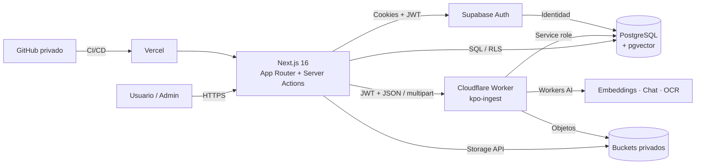
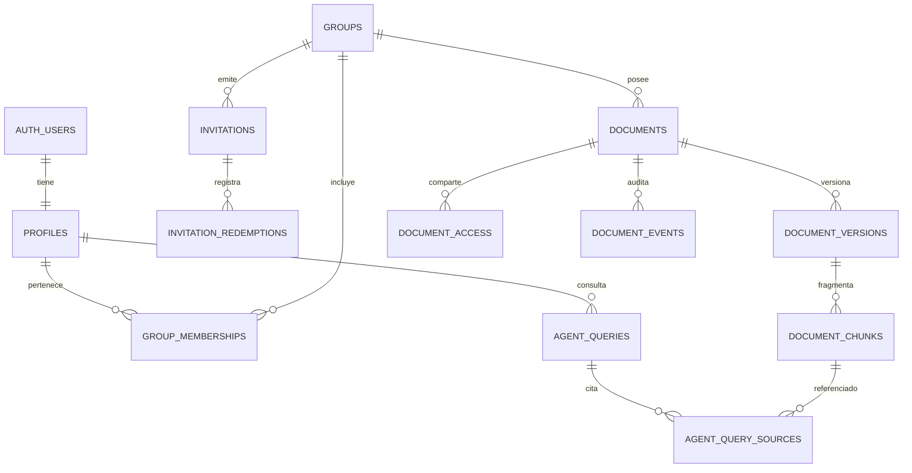

# KPO-AGENT-IA

Aplicación web para consulta documental en auditoría, contabilidad y cumplimiento. Combina autenticación por invitación, aislamiento por grupos, gestión documental con OCR y versionado, y un agente RAG que responde únicamente con versiones publicadas, cita los fragmentos usados y se abstiene cuando no hay evidencia suficiente.

[](https://nextjs.org/)
[](https://react.dev/)
[](https://www.typescriptlang.org/)
[](https://supabase.com/)
[](https://workers.cloudflare.com/)
[](#pruebas)

- **Repositorio:** <https://github.com/Nicode369/KPO-AGENT-IA>
- **Arquitectura detallada:** [`docs/ARCHITECTURE.md`](docs/ARCHITECTURE.md)
- **Despliegue:** [`docs/DEPLOYMENT.md`](docs/DEPLOYMENT.md)
- **Memoria técnica:** [`docs/PROJECT_MEMORY.md`](docs/PROJECT_MEMORY.md)

## Índice

- [Qué resuelve](#qué-resuelve)
- [Estado del proyecto](#estado-del-proyecto)
- [Capacidades](#capacidades)
- [Arquitectura](#arquitectura)
- [Tecnologías](#tecnologías)
- [Estructura del repositorio](#estructura-del-repositorio)
- [Puesta en marcha](#puesta-en-marcha)
- [Variables de entorno](#variables-de-entorno)
- [Migraciones](#migraciones)
- [Rutas de la aplicación](#rutas-de-la-aplicación)
- [API](#api)
- [Modelo de datos](#modelo-de-datos)
- [Roles y permisos](#roles-y-permisos)
- [Seguridad](#seguridad)
- [Pruebas](#pruebas)
- [Despliegue](#despliegue)
- [Limitaciones conocidas](#limitaciones-conocidas)
- [Fases pendientes](#fases-pendientes)

## Qué resuelve

El proyecto implementa el Reto 3 KPO Agent AI con una arquitectura desacoplada:

- **Next.js** sirve la interfaz, las rutas privadas, las server actions y las APIs internas.
- **Supabase** concentra Auth, PostgreSQL con `pgvector`, RLS y Storage privado.
- **Cloudflare Workers** ejecuta ingesta, OCR, embeddings y chat mediante Workers AI.
- **Vercel** es el destino previsto para la aplicación Next.js; el Worker se despliega por separado en Cloudflare.

El principio central es que el agente **no responde con conocimiento general**: recupera fragmentos autorizados de versiones publicadas, construye el contexto, valida citas y registra la consulta. Si no alcanza la evidencia, se abstiene.

## Estado del proyecto

| Fase | Alcance | Estado |
| --- | --- | --- |
| 1 | Inspección y planificación | ✅ Completada |
| 2 | Estructura base, diseño y navegación | ✅ Completada |
| 3 | Base de datos, Auth, invitaciones, roles y RLS | ✅ Completada |
| 4 | Gestión documental, OCR, publicación y versionado | ✅ Completada en local |
| 5 | Agente RAG, citas, abstención, seguridad e historial | ✅ Completada en local |
| 6 | Auditoría y trazabilidad ampliada | 🚧 Parcial: `agent_queries`, `agent_query_sources`, `document_events`, hashes, historial personal y visor administrativo `/admin/audit`; falta cadena de hashes global, reportes y verificador |
| 7 | Simulador de pruebas | ⏳ Pendiente |
| 8 | Integración y despliegue | 🚧 En preparación: código y documentación listos; falta publicar Worker, Vercel y configurar Auth/redirects |

El repositorio incluye una validación local con **15 documentos, 1.185 fragmentos, todos publicados como `common`**. Ese corpus no se versiona: vive fuera del repositorio, en `../base_drive/`, y se ignora mediante `.gitignore`.

## Capacidades

### Identidad, grupos e invitaciones

- Registro exclusivamente por invitación; no hay registro público sin código.
- Códigos de 6 caracteres en mayúsculas, con alfabeto sin caracteres ambiguos.
- Validación por hash SHA-256 y consumo atómico mediante trigger de Auth.
- Invitaciones con vigencia, límite de usos, revocación e historial.
- Roles `group_admin`, `supervisor` y `analyst`, más `superadmin`.
- Membresías activas, pendientes y deshabilitadas.
- Revocación de sesiones para superadministradores.
- RLS y RPCs `security definer` para administración; ocultar botones no sustituye los controles de servidor.

### Gestión documental

- Carga privada de PDF y DOCX.
- Validación de extensión, MIME, firma, tamaño y duplicados por SHA-256.
- Extracción de texto; OCR de PDFs escaneados con Mistral Small 3.1 Vision.
- Normalización de texto y persistencia del Markdown extraído.
- Fragmentación de ~1.400 caracteres con 200 de solapamiento.
- Embeddings multilingües de 1.024 dimensiones con BGE-M3.
- Almacenamiento de vectores en PostgreSQL con `pgvector` e índice HNSW.
- Flujo de revisión: `pending_review`, `approved`, `published`, `retired`, `error`.
- Publicación explícita y atómica de una versión.
- Versionado inmutable; los usuarios normales solo ven la versión publicada.
- Buckets privados `documents-original` y `documents-processed`.
- URLs firmadas de corta duración para administradores autorizados.
- Eventos del ciclo de vida en `document_events`.

### Agente RAG

- Recuperación semántica restringida por grupo y por versión publicada.
- Respuesta en español basada solo en el contexto recuperado.
- Citas obligatorias a fragmentos, documento, versión y página.
- Abstención explícita cuando la evidencia es insuficiente.
- Validación determinista de citas y del formato de respuesta.
- Clasificador de seguridad contra:
  - extracción del prompt del sistema;
  - solicitudes de secretos o credenciales;
  - acceso a información de otros grupos;
  - extracción masiva de documentos.
- Límite de 20 consultas por minuto por usuario.
- Historial personal en `/app/history` con resultado, modelo, latencia, grounding y fuentes.
- Auditoría en `agent_queries` y `agent_query_sources`, incluyendo hashes de pregunta y respuesta.

### Administración

- `/admin/groups`: crear y listar grupos.
- `/admin/invitations`: generar, copiar y revocar invitaciones.
- `/admin/users`: cambiar rol, estado y revocar sesiones.
- `/admin/documents`: cargar, procesar, revisar, aprobar, publicar, retirar y versionar.
- `/admin/documents/[id]`: detalle de versiones, fragmentos, accesos, eventos y errores.
- `/admin/audit`: historial global de consultas para superadmin y acotado a sus grupos para `group_admin`, con filtros por resultado, grupo, usuario, fechas y texto.
- `/admin/security`: intentos bloqueados y rechazados de los grupos administrados.
- Panel de resumen con miembros, invitaciones, documentos, consultas y alertas.
- Contador global de fragmentos indexados.

## Arquitectura



**Flujo de una consulta:** navegador → `/api/agent/query` → clasificador y rate limit → Worker `/embed` → BGE-M3 → `match_document_chunks` con RLS → Worker `/chat` → Gemma → validación de citas → `record_agent_query` → respuesta con fuentes.

**Flujo documental:** admin → `/api/admin/documents/upload` → Worker `/ingest` → validación y hash → Storage original → extracción/OCR → normalización → chunking → embeddings → `document_chunks` → revisión → `publish_document` → disponible para el agente.

Los diagramas de secuencia, el modelo entidad-relación completo y la topología de despliegue están en [`docs/ARCHITECTURE.md`](docs/ARCHITECTURE.md).

## Tecnologías

| Capa | Tecnología | Uso |
| --- | --- | --- |
| Frontend | Next.js 16.4.5, React 19.3, App Router | Rutas, layouts, server components, server actions |
| Lenguaje | TypeScript 5 | Tipado estricto en app y Worker |
| Estilos | CSS propio + variables; Tailwind CSS 4 instalado | Diseño responsive, componentes y sistema visual |
| Auth | Supabase Auth + `@supabase/ssr` | Sesiones en cookies, login, registro por invitación |
| Base de datos | Supabase PostgreSQL + `pgvector` | Datos, RLS, búsqueda vectorial, RPCs |
| Storage | Supabase Storage | PDFs originales y Markdown procesado, buckets privados |
| Backend IA | Cloudflare Workers + TypeScript | Ingesta, OCR, embeddings, chat y endpoints internos |
| Modelos | BGE-M3, Gemma, Mistral Small 3.1 | Embeddings, generación y OCR |
| Procesamiento | `unpdf`, Workers AI `toMarkdown` | Extracción de PDF/DOCX |
| Tests | Vitest 3, Vitest 5 (Worker), Playwright 1.65 | Unitarias, Worker y E2E |
| Calidad | ESLint 9, `eslint-config-next`, `tsc --noEmit` | Lint y typecheck |
| Deploy | Vercel + Cloudflare + Supabase | Hosting previsto de app, Worker y datos |
| Git | GitHub privado | Versionado y despliegue continuo |

## Estructura del repositorio

```text
.
├── src/
│   ├── app/
│   │   ├── (auth)/                 # login, registro, recuperación, verificación
│   │   ├── (workspace)/app/        # dashboard, agente e historial
│   │   ├── (workspace)/admin/      # grupos, invitaciones, usuarios, documentos
│   │   ├── api/agent/query/        # endpoint RAG autenticado
│   │   ├── api/admin/documents/    # proxies multipart al Worker
│   │   ├── auth/                   # server actions y callback de Auth
│   │   └── globals.css             # sistema visual completo
│   ├── components/                 # shell, navegación, consola, iconos, formularios
│   ├── lib/
│   │   ├── admin/                  # consultas administrativas y documentos
│   │   ├── agent/                  # prompt, seguridad, tipos y validación
│   │   ├── auth/                   # guardas de sesión, rol y grupo
│   │   └── supabase/               # clientes browser/server, proxy y env
│   └── proxy.ts                    # renovación de sesión en Next.js 16
├── supabase/
│   ├── migrations/                 # fuente de verdad del esquema
│   └── config.toml
├── workers/kpo-ingest/             # Worker de ingesta, OCR y modelos
├── scripts/ingest-base-drive.mjs   # ingesta masiva local
├── e2e/                            # Playwright
├── docs/                           # arquitectura, despliegue y memoria
└── public/                         # activos estáticos
```

## Puesta en marcha

### Requisitos

- Node.js 20.9 o superior; desarrollo validado con Node.js 22.22.0.
- npm 10 o superior.
- Proyecto de Supabase con Auth, PostgreSQL, `pgvector` y Storage.
- Cuenta de Cloudflare con Workers AI para el Worker.
- Opcional: Docker y Supabase CLI para desarrollo local de la base.

### 1. Instalar la aplicación

```bash
git clone https://github.com/Nicode369/KPO-AGENT-IA.git
cd KPO-AGENT-IA
npm install
cp .env.example .env.local
```

Completa `.env.local` con los valores reales. Nunca lo subas al repositorio.

### 2. Aplicar migraciones

Aplica los archivos de `supabase/migrations/` en orden. Puedes usar el Dashboard o la CLI:

```bash
supabase start
supabase db reset
supabase status
```

Para el proyecto remoto, vincula el proyecto y ejecuta `supabase db push`, o aplica el SQL manualmente en orden.

### 3. Instalar y ejecutar el Worker

```bash
cd workers/kpo-ingest
npm install
cp .dev.vars.example .dev.vars
# completa SUPABASE_URL, SUPABASE_ANON_KEY y SUPABASE_SERVICE_ROLE_KEY
npx wrangler login
npm run typecheck
npm run dry-run
npm run dev
```

El Worker local queda en `http://localhost:8787`. Configura `INGEST_WORKER_URL=http://localhost:8787` en `.env.local`.

### 4. Crear la primera cuenta superadministradora

El primer usuario no se registra desde `/register` porque el registro exige invitación. Créalo desde el Admin API de Supabase con `app_metadata.bootstrap_superadmin = true`:

```bash
curl -X POST "$NEXT_PUBLIC_SUPABASE_URL/auth/v1/admin/users" \
  -H "apikey: $SUPABASE_SERVICE_ROLE_KEY" \
  -H "Authorization: Bearer $SUPABASE_SERVICE_ROLE_KEY" \
  -H "Content-Type: application/json" \
  -d '{
    "email": "tu-correo@dominio.com",
    "password": "TU_CONTRASEÑA_SEGURA",
    "email_confirm": true,
    "app_metadata": { "bootstrap_superadmin": true }
  }'
```

La migración acepta esa marca una sola vez, cuando todavía no existe ningún superadministrador, y la elimina al crear el perfil. No la establezcas desde `user_metadata`.

### 5. Ejecutar la app

```bash
npm run dev
```

Abre <http://localhost:3000>. Sin Supabase configurado, los formularios muestran que la integración no está disponible.

### 6. Ingesta opcional del corpus local

```bash
# desde la raíz del repo
npm run ingest:base-drive -- --dry-run
npm run ingest:base-drive
```

El script usa `INGEST_EMAIL`, `INGEST_PASSWORD`, `INGEST_GROUP_ID`, `INGEST_GROUP_SLUG` y `BASE_DRIVE_DIR`. Requiere una cuenta `group_admin` del grupo destino. `base_drive/` está ignorado y no forma parte del repositorio.

### 7. Confirmación de correo

La configuración actual usa **Confirm email desactivado** para evitar el límite 429 del SMTP integrado de Supabase. Las cuentas creadas desde el panel de Auth ya están confirmadas. Si se requiere verificación real, configura un proveedor SMTP propio y reactiva la confirmación; el trigger ya deja la membresía pendiente hasta que el usuario confirme.

> Sin SMTP propio, la recuperación de contraseña por correo no es fiable. El login con contraseña sí funciona.

## Variables de entorno

### Aplicación Next.js

| Variable | Ámbito | Uso |
| --- | --- | --- |
| `NEXT_PUBLIC_SUPABASE_URL` | Público | URL del proyecto Supabase |
| `NEXT_PUBLIC_SUPABASE_PUBLISHABLE_KEY` | Público | Clave publicable para el cliente |
| `APP_ORIGIN` | Servidor | Origen usado en redirects de Auth |
| `INGEST_WORKER_URL` | Servidor | URL del Worker de ingesta y modelos |
| `SUPABASE_SERVICE_ROLE_KEY` | Servidor | Panel de alertas de seguridad y scripts/bootstrap; nunca en el navegador |

### Worker de Cloudflare

| Variable | Tipo | Uso |
| --- | --- | --- |
| `SUPABASE_URL` | Secreto | URL del proyecto Supabase |
| `SUPABASE_ANON_KEY` | Secreto | Validación de JWT de usuarios |
| `SUPABASE_SERVICE_ROLE_KEY` | Secreto | Ingesta y escritura controlada en Postgres/Storage |
| `ALLOWED_ORIGINS` | Var | Orígenes permitidos para CORS |
| `AI_EMBEDDING_MODEL` | Var | Modelo de embeddings; por defecto BGE-M3 |
| `AI_CHAT_MODEL` | Var | Modelo de chat; por defecto Gemma |
| `AI_OCR_MODEL` | Var | Modelo de OCR; por defecto Mistral Small 3.1 |
| `OCR_MIN_TEXT_CHARS` | Var | Umbral para decidir OCR |
| `MAX_UPLOAD_BYTES` | Var | Tamaño máximo de carga |

### Script de ingesta masiva

| Variable | Uso |
| --- | --- |
| `INGEST_EMAIL` | Cuenta `group_admin` que ejecuta la ingesta |
| `INGEST_PASSWORD` | Contraseña de esa cuenta |
| `INGEST_GROUP_ID` | UUID del grupo destino |
| `INGEST_GROUP_SLUG` | Slug del grupo, por defecto `kpo` |
| `BASE_DRIVE_DIR` | Ruta local del corpus |

## Migraciones

| # | Archivo | Contenido |
| --- | --- | --- |
| 1 | `202611060001_initial_identity_and_access.sql` | Grupos, perfiles, membresías, invitaciones, trigger de Auth, RLS y RPCs |
| 2 | `202611070001_invitation_long_expiry.sql` | Vigencia de invitaciones a 365 días |
| 3 | `202611080001_short_invitation_codes.sql` | Códigos de 6 caracteres y compatibilidad heredada |
| 4 | `202611090001_invitation_code_history.sql` | Historial de códigos y RPC autorizada |
| 5 | `202611090002_revoke_user_sessions.sql` | `sessions_revoked_at` y revocación de sesiones |
| 6 | `202611100001_documents_and_ingestion.sql` | Documentos, versiones, chunks, pgvector, eventos, buckets y RPCs |
| 7 | `202611110001_document_version_publication.sql` | `published_version_id`, RLS por versión y publicación/retiro |
| 8 | `202611110002_agent_retrieval.sql` | `match_document_chunks`, `agent_queries` y `agent_query_sources` |

Las migraciones 1–8 están aplicadas en el proyecto remoto usado durante el desarrollo. Verifica siempre el estado en el Dashboard antes de un despliegue nuevo.

## Rutas de la aplicación

| Ruta | Acceso | Descripción |
| --- | --- | --- |
| `/` | Público | Landing |
| `/login`, `/register`, `/forgot-password`, `/reset-password`, `/verify-email` | Público | Flujos de autenticación |
| `/app` | Usuario activo | Dashboard y consola del agente |
| `/app/history` | Usuario activo | Historial personal de consultas |
| `/admin` | Superadmin / `group_admin` | Resumen administrativo |
| `/admin/groups` | Superadmin | Crear y listar grupos |
| `/admin/invitations` | Superadmin / `group_admin` | Generar, copiar y revocar invitaciones |
| `/admin/users` | Superadmin / `group_admin` | Roles, estados y revocación de sesiones |
| `/admin/documents` | Superadmin / `group_admin` | Biblioteca y carga documental |
| `/admin/documents/[id]` | Superadmin / `group_admin` | Detalle, versiones, fragmentos y eventos |
| `/admin/audit` | Superadmin / `group_admin` | Historial global o acotado a sus grupos |
| `/admin/security` | Superadmin / `group_admin` | Intentos bloqueados y rechazados |
| `/api/agent/query` | Usuario activo | Consulta RAG |
| `/api/admin/documents/upload` | Superadmin / `group_admin` | Proxy multipart al Worker |
| `/api/admin/documents/[id]/versions` | Superadmin / `group_admin` | Nueva versión |
| `/auth/callback` | Público | Intercambio de código de Auth |

## API

### Cloudflare Worker

| Método | Endpoint | Auth | Función |
| --- | --- | --- | --- |
| `GET` | `/health` | Pública | Estado del servicio y bindings |
| `POST` | `/embed-test` | JWT | Prueba de embeddings BGE-M3 |
| `POST` | `/embed` | JWT | Embedding de la pregunta |
| `POST` | `/chat` | JWT | Generación con el modelo configurado |
| `POST` | `/ingest` | Superadmin / `group_admin` | Validación, almacenamiento y procesamiento |
| `POST` | `/documents/:id/process` | Superadmin / `group_admin` | Reprocesar versión actual |
| `POST` | `/documents/:id/versions` | Superadmin / `group_admin` | Crear y procesar nueva versión |

### Next.js

| Método | Endpoint | Auth | Función |
| --- | --- | --- | --- |
| `POST` | `/api/agent/query` | Sesión activa | Clasificación, rate limit, RAG, citas y auditoría |
| `POST` | `/api/admin/documents/upload` | Admin | Reenvía multipart al Worker |
| `POST` | `/api/admin/documents/[id]/versions` | Admin | Reenvía nueva versión al Worker |

## Modelo de datos



- `documents` guarda la versión vigente y `published_version_id`.
- `document_versions` conserva original, extracción, `chunk_count`, estado y error.
- `document_chunks` contiene `vector(1024)`, metadatos de página/sección/artículo/numeral e índice HNSW coseno.
- `document_access` autoriza grupos adicionales para documentos restringidos.
- `agent_queries` / `agent_query_sources` guardan la auditoría de cada consulta y sus fuentes.

## Roles y permisos

| Capacidad | Superadmin | `group_admin` | `supervisor` | `analyst` |
| --- | --- | --- | --- | --- |
| Consultar documentos publicados de su grupo | ✅ Global | ✅ Su grupo | ✅ Su grupo | ✅ Su grupo |
| Historial personal | ✅ | ✅ | ✅ | ✅ |
| Crear grupos | ✅ | ❌ | ❌ | ❌ |
| Gestionar invitaciones | ✅ Global | ✅ Su grupo | ❌ | ❌ |
| Gestionar miembros y roles | ✅ Global | ✅ Su grupo, sin asignar `group_admin` | ❌ | ❌ |
| Gestionar documentos | ✅ Global | ✅ Su grupo | ❌ | ❌ |
| Publicar/retirar versiones | ✅ Global | ✅ Su grupo | ❌ | ❌ |
| Revocar sesiones | ✅ | ❌ | ❌ | ❌ |
| Historial de consultas administrativo | ✅ Global | ✅ Su grupo | ❌ | ❌ |
| Auditoría global / reportes | 🚧 Fase 6 | 🚧 Fase 6 | 🚧 Fase 6 | ❌ |
| Simulador | 🚧 Fase 7 | 🚧 Fase 7 | 🚧 Fase 7 | ❌ |

Hoy `supervisor` y `analyst` comparten el acceso de consulta. Las capacidades de seguimiento de actividad y ejecución de pruebas del supervisor llegarán con las fases 6 y 7.

## Seguridad

- **Autenticación:** Supabase Auth con sesiones en cookies y renovación en `src/proxy.ts`.
- **Autorización en servidor:** `requireWorkspaceUser` y `requireAdminUser` validan perfil activo, membresía, rol y revocación de sesión.
- **RLS:** todas las lecturas sensibles se limitan en PostgreSQL; los usuarios normales solo ven la versión publicada de documentos autorizados.
- **RPCs `security definer`:** invitaciones, membresías, publicación y auditoría se ejecutan mediante funciones con permisos controlados.
- **Aislamiento por grupo:** documentos, chunks, Storage y consultas se filtran por grupo.
- **Storage privado:** buckets sin acceso público; el frontend solo recibe URLs firmadas de corta duración.
- **Secretos:** `SUPABASE_SERVICE_ROLE_KEY` y tokens de Cloudflare viven solo en servidor/Worker. `.env.local`, `.dev.vars` y archivos de claves están ignorados.
- **Agente:** clasificador determinista, citas obligatorias, abstención, rate limit de 20 consultas/minuto y bloqueo de extracción masiva.
- **Auditoría:** hashes SHA-256 de pregunta/respuesta, fuentes recuperadas, modelo, latencia y grounding en `agent_queries`.
- **Git:** repositorio privado; el historial fue escaneado para descartar claves, JWT, correos y URLs reales.

## Pruebas

| Suite | Comando | Cobertura |
| --- | --- | --- |
| Web unitarias | `npm test` | 14 tests: prompt, seguridad, citas y conteo de fragmentos |
| Worker | `cd workers/kpo-ingest && npm test` | 16 tests: OCR, archivos, chunking y documentos |
| E2E | `npm run test:e2e` | 2 tests: autenticación y rutas privadas sin overlays de Next |
| Lint | `npm run lint` | ESLint + reglas de Next |
| Build | `npm run build` | Next.js producción con webpack |
| Typecheck Worker | `npm run typecheck` | TypeScript estricto |

Para E2E:

```bash
npx playwright install chromium
npm run dev
npm run test:e2e
```

Las pruebas E2E cargan `.env.local`, verifican `/login`, `/app`, `/app/history`, `/admin`, `/admin/invitations`, `/admin/documents`, `/admin/users`, `/admin/groups`, `/admin/audit` y `/admin/security`, y fallan si aparece un overlay de ruta bloqueada o un valor inestable de Next.js.

## Despliegue

Arquitectura objetivo:

- **Vercel** para Next.js.
- **Cloudflare Worker** para ingesta y modelos.
- **Supabase** para Auth, Postgres, pgvector y Storage.

El proyecto **todavía no está desplegado**. La guía completa, variables, secretos, redirect URLs, smoke tests y rollback están en [`docs/DEPLOYMENT.md`](docs/DEPLOYMENT.md).

Resumen:

1. Aplicar/verificar migraciones y buckets privados.
2. Configurar secretos del Worker y desplegarlo.
3. Importar el repo privado en Vercel.
4. Configurar `NEXT_PUBLIC_SUPABASE_*`, `INGEST_WORKER_URL` y `APP_ORIGIN`.
5. Configurar Site URL y Redirect URLs en Supabase Auth.
6. Ejecutar smoke tests con superadmin y `analyst`.
7. Verificar que los buckets sigan privados y que los logs no expongan datos.

## Limitaciones conocidas

- **Fases 6 y 7 incompletas:** el visor de historial administrativo ya existe; faltan cadena de hashes append-only, reportes, exportación, verificador y simulador.
- **Sin despliegue todavía:** no hay URL pública; `APP_ORIGIN` e `INGEST_WORKER_URL` apuntan a local.
- **OCR síncrono:** el procesamiento ocurre dentro del request; `maxDuration = 60` puede ser insuficiente para PDFs muy grandes.
- **Límite de Vercel:** el proxy multipart puede limitar cuerpos grandes (~4.5 MB). El corpus actual está por debajo; para documentos mayores conviene cola o carga directa.
- **Sin SMTP propio:** confirmación de correo desactivada; recuperación de contraseña por correo no fiable.
- **Rate limit no probado bajo carga real.**
- **OCR de imágenes embebidas en DOCX no implementado.**
- **Supervisor sin flujo propio:** hoy consulta como analyst; seguimiento y pruebas quedan para fases 6/7.
- **Datos de validación locales:** los 15 documentos y 1.185 fragmentos no forman parte del repo.
- **Integración de proveedor de IA:** la capa está separada en el Worker, pero cambiar de proveedor requiere adaptar `workers/kpo-ingest/src`.

## Fases pendientes

1. **Fase 6 — Auditoría y trazabilidad:** visor `/admin/audit` implementado; falta `audit_events` append-only con cadena SHA-256, eventos de login/logout/fallos, cambios administrativos, reportes, exportación y verificador.
2. **Fase 7 — Simulador:** tablas `simulator_cases`, `simulator_runs`, `simulator_results`; reutilización de `runAgentQuery`; UI `/admin/simulator`; métricas de acierto, abstención, citas y latencia; ejecución por lotes.
3. **Fase 8 — Cierre:** desplegar Worker y app, configurar Auth/redirects, backups, monitoreo, smoke tests y documentación final.
4. **Mejoras operativas:** mover OCR a cola, probar rate limit con carga, añadir SMTP si se requiere verificación real y ampliar E2E a flujos de grupo.

## Documentación

- [`docs/ARCHITECTURE.md`](docs/ARCHITECTURE.md): componentes, flujos, ERD, roles, API y decisiones.
- [`docs/DEPLOYMENT.md`](docs/DEPLOYMENT.md): despliegue Vercel + Cloudflare + Supabase.
- [`docs/PROJECT_MEMORY.md`](docs/PROJECT_MEMORY.md): memoria técnica y estado detallado.
- [`AGENTS.md`](AGENTS.md): comandos y reglas operativas para agentes de desarrollo.
- [`supabase/migrations/`](supabase/migrations/): fuente de verdad del esquema.
