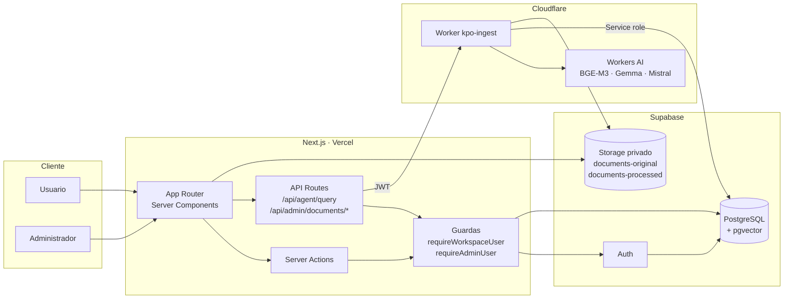
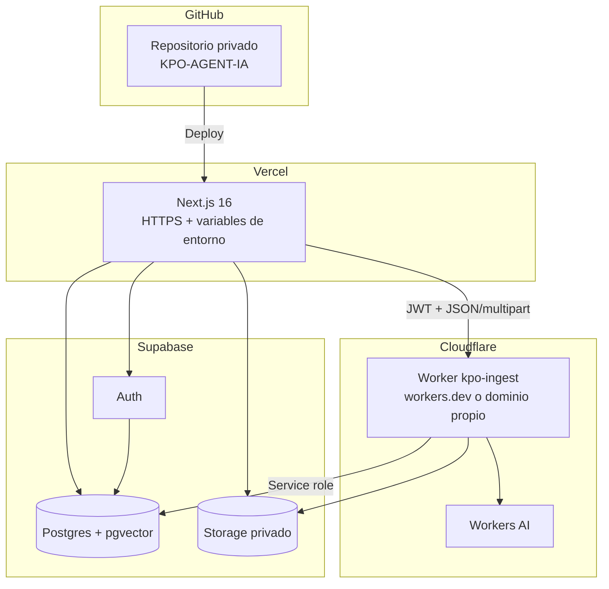
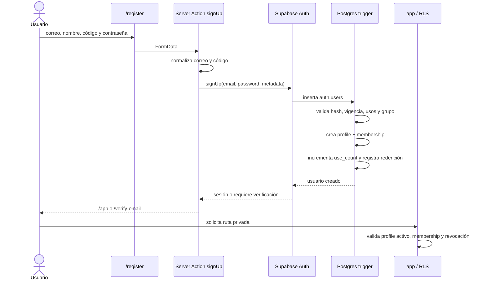
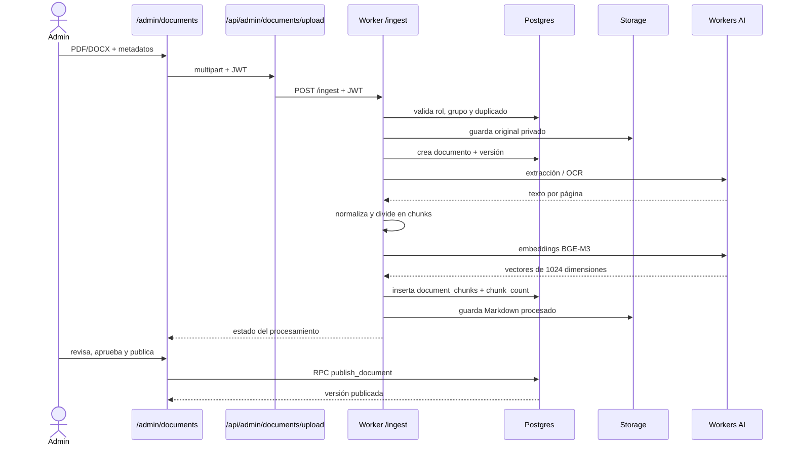
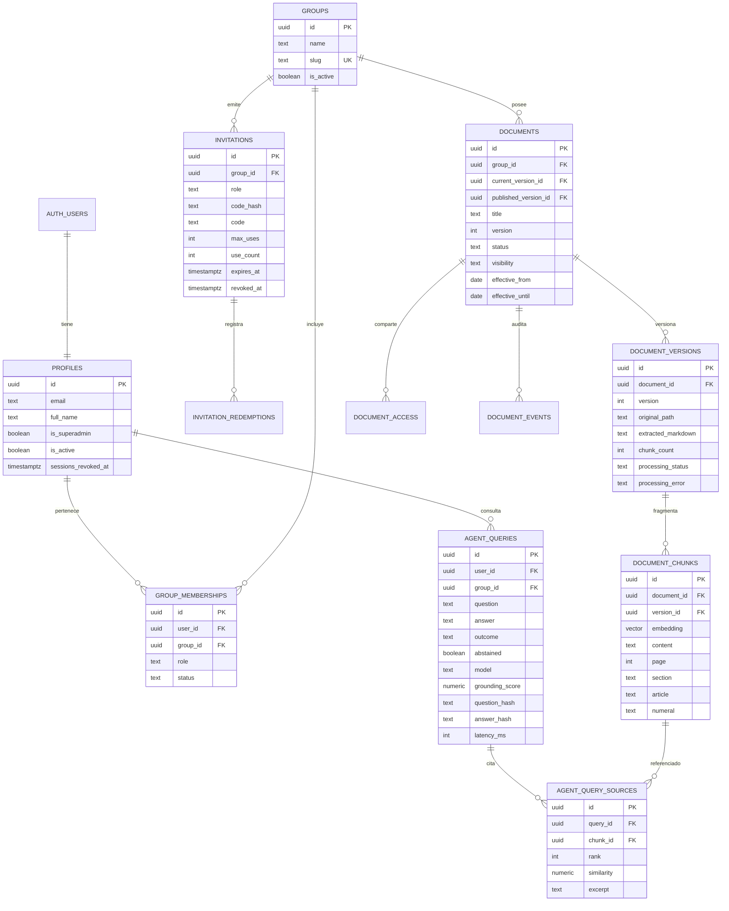

# Arquitectura — KPO Agent AI

Documento técnico del Reto 3 KPO Agent AI. Describe componentes, flujos, modelo de datos, permisos, API, decisiones y límites conocidos.

## 1. Visión general

La aplicación separa responsabilidades en tres planos:

1. **Next.js** — experiencia de usuario, sesión, autorización de rutas, server actions y APIs internas.
2. **Supabase** — identidad, PostgreSQL con `pgvector`, RLS, RPCs y Storage privado.
3. **Cloudflare Worker** — ingesta documental, OCR, embeddings y chat mediante Workers AI.

El navegador nunca recibe la service role key. Las operaciones sensibles pasan por servidor: Next.js o el Worker. La autorización se aplica en la aplicación y se vuelve a limitar en PostgreSQL mediante RLS.

## 2. Diagrama de componentes

## 3. Topología de despliegue

Estado actual: app y Worker validados en local; despliegue público pendiente. La guía operativa está en [`DEPLOYMENT.md`](DEPLOYMENT.md).

## 4. Flujo de autenticación y registro por invitación

### Sesión

- `@supabase/ssr` mantiene la sesión en cookies.
- `src/proxy.ts` renueva la sesión en cada request.
- `requireWorkspaceUser()` valida:
  - JWT con `sub`;
  - perfil activo;
  - `sessions_revoked_at` contra `iat`;
  - al menos una membresía activa, salvo superadmin.
- `requireAdminUser()` exige `is_superadmin` o rol `group_admin`.
- La autorización de datos se repite en PostgreSQL con RLS.

### Invitaciones

1. Admin genera una invitación mediante RPC.
2. Se guardan `code_hash` (validación) y `code` (historial autorizado).
3. El registro envía el código en metadata.
4. El trigger de `auth.users` valida y consume la invitación de forma atómica.
5. Se crean `profiles` y `group_memberships`.
6. El código se elimina de la metadata del usuario.

## 5. Flujo documental

### Procesamiento

- **DOCX:** `env.AI.toMarkdown`.
- **PDF:** `unpdf` extrae texto e imágenes por página.
- **OCR:** si una página tiene menos de `OCR_MIN_TEXT_CHARS` (40 por defecto), la imagen se envía a `@cf/mistralai/mistral-small-3.1-24b-instruct`.
- **Preparación OCR:** ancho 1400 px, alto máximo 2400 px, franjas de 850 px con 80 px de solapamiento, máximo 4 imágenes por página.
- **Normalización:** elimina sellos administrativos y preámbulos conversacionales, conserva estructura útil.
- **Chunking:** ~1.400 caracteres con 200 de solapamiento; líneas largas se segmentan.
- **Embeddings:** `@cf/baai/bge-m3`, 1.024 dimensiones, multilingüe.
- **Persistencia:** original en `documents-original`, Markdown en `documents-processed`, fragmentos en `document_chunks`.

### Versionado y publicación

- Cada versión es inmutable.
- `documents.version` apunta a la versión vigente de trabajo.
- `documents.published_version_id` apunta a la versión consultable.
- Los usuarios normales solo leen la versión publicada.
- Los administradores pueden leer todas las versiones de su grupo.
- `publish_document` y `retire_document` son RPCs atómicas.
- Se puede cargar una nueva versión sin retirar la publicada hasta publicar la nueva.

## 6. Flujo de consulta RAG

```mermaid
sequenceDiagram
  actor U as Usuario
  participant UI as /app
  participant API as /api/agent/query
  participant W as Worker
  participant AI as Workers AI
  participant DB as Postgres
  participant H as Historial

  U->>UI: pregunta
  UI->>API: POST + JWT
  API->>API: valida sesión y pregunta
  API->>API: clasificador de seguridad + rate limit
  alt pregunta bloqueada
    API->>DB: registra outcome blocked
    API-->>UI: respuesta de bloqueo
  else pregunta permitida
    API->>W: POST /embed
    W->>AI: BGE-M3
    AI-->>W: vector 1024
    W-->>API: embedding
    API->>DB: match_document_chunks (RLS)
    DB-->>API: chunks publicados autorizados
    alt evidencia insuficiente
      API->>DB: registra abstención
      API-->>UI: abstención sin fuentes
    else evidencia suficiente
      API->>W: POST /chat con contexto
      W->>AI: Gemma
      AI-->>W: respuesta
      W-->>API: respuesta
      API->>API: valida citas y grounding
      API->>DB: record_agent_query + fuentes
      API-->>UI: respuesta + citas
    end
  end
  DB-->>H: /app/history
```

### Reglas del agente

- Responde solo con fragmentos recuperados de versiones publicadas.
- No usa conocimiento externo ni documentos no autorizados.
- Debe citar fragmento, documento, versión y página cuando corresponda.
- Si no hay evidencia suficiente, se abstiene con un mensaje explícito.
- Si la respuesta no contiene citas válidas, se rechaza.
- Clasificador determinista bloquea:
  - extracción del prompt del sistema;
  - solicitudes de secretos o credenciales;
  - información de otros grupos;
  - extracción masiva.
- Rate limit: 20 consultas por minuto por usuario.
- Toda consulta, incluida una abstención o bloqueo, se intenta registrar en auditoría.

## 7. Modelo de datos

### Tablas principales

| Tabla | Propósito |
| --- | --- |
| `profiles` | Perfil por usuario de Auth; superadmin, estado y revocación |
| `groups` | Grupos de trabajo y aislamiento |
| `group_memberships` | Rol y estado por usuario/grupo |
| `invitations` | Código, hash, vigencia, usos y revocación |
| `invitation_redemptions` | Auditoría de canjes |
| `documents` | Documento lógico, versión vigente y publicada |
| `document_versions` | Original, extracción, estado y conteo de chunks |
| `document_chunks` | Fragmentos y vectores para búsqueda semántica |
| `document_access` | Accesos adicionales para documentos restringidos |
| `document_events` | Ciclo de vida documental |
| `agent_queries` | Auditoría de preguntas, respuestas y resultados |
| `agent_query_sources` | Fragmentos usados como evidencia |

### Buckets

- `documents-original`: PDF/DOCX originales.
- `documents-processed`: Markdown extraído y normalizado.

Ambos son privados. Las políticas de Storage validan el grupo en la ruta `originals/{group_id}/...` y `processed/{group_id}/...`.

## 8. Matriz de roles y permisos

| Capacidad | Superadmin | `group_admin` | `supervisor` | `analyst` |
| --- | --- | --- | --- | --- |
| Consultar documentos publicados | Global | Su grupo | Su grupo | Su grupo |
| Ver historial personal | ✅ | ✅ | ✅ | ✅ |
| Crear grupos | ✅ | ❌ | ❌ | ❌ |
| Crear/revocar invitaciones | Global | Su grupo | ❌ | ❌ |
| Ver códigos de invitación | Global | Su grupo | ❌ | ❌ |
| Gestionar membresías | Global | Su grupo | ❌ | ❌ |
| Asignar `group_admin` | ✅ | ❌ | ❌ | ❌ |
| Activar/desactivar cuentas | ✅ | ❌ | ❌ | ❌ |
| Revocar sesiones | ✅ | ❌ | ❌ | ❌ |
| Cargar/procesar documentos | Global | Su grupo | ❌ | ❌ |
| Aprobar/publicar/retirar | Global | Su grupo | ❌ | ❌ |
| Ver todas las versiones | Global | Su grupo | ❌ | ❌ |
| Auditoría global / reportes | 🚧 Fase 6 | 🚧 Fase 6 | 🚧 Fase 6 | ❌ |
| Seguimiento de actividad | 🚧 Fase 6 | 🚧 Fase 6 | 🚧 Fase 6 | ❌ |
| Ejecutar simulador | 🚧 Fase 7 | 🚧 Fase 7 | 🚧 Fase 7 | ❌ |

`supervisor` todavía no tiene un flujo administrativo propio; actualmente consulta como `analyst`. Las capacidades de revisión, seguimiento y pruebas se completarán en las fases 6 y 7.

## 9. API

### Worker de Cloudflare

| Método | Endpoint | Autorización | Descripción |
| --- | --- | --- | --- |
| `GET` | `/health` | Pública | Bindings, modelos configurados y estado |
| `POST` | `/embed-test` | JWT | Prueba de embeddings con BGE-M3 |
| `POST` | `/embed` | JWT | Embedding de la pregunta |
| `POST` | `/chat` | JWT | Generación con el modelo configurado |
| `POST` | `/ingest` | Superadmin / `group_admin` | Ingesta completa |
| `POST` | `/documents/:id/process` | Superadmin / `group_admin` | Reprocesar versión actual |
| `POST` | `/documents/:id/versions` | Superadmin / `group_admin` | Nueva versión |

### Next.js

| Método | Endpoint | Autorización | Descripción |
| --- | --- | --- | --- |
| `POST` | `/api/agent/query` | Sesión activa | RAG, seguridad, citas y auditoría |
| `POST` | `/api/admin/documents/upload` | Admin | Proxy multipart al Worker |
| `POST` | `/api/admin/documents/[id]/versions` | Admin | Proxy de nueva versión |

### Convenciones de error

Las APIs devuelven JSON con `error.message` y códigos HTTP coherentes:

- `400` — entrada inválida.
- `401` — sesión ausente o expirada.
- `403` — origen, rol o grupo no autorizado.
- `409` — documento duplicado o conflicto de versión.
- `413` — archivo demasiado grande.
- `422` — archivo no procesable.
- `429` — rate limit.
- `502/503` — Worker, modelo o esquema no disponible.

## 10. Seguridad

### Controles implementados

- RLS en tablas de negocio y Storage.
- RPCs `security definer` para operaciones administrativas.
- Validación de sesión, perfil y membresía en cada request privada.
- Revocación de sesiones mediante `sessions_revoked_at`.
- Buckets privados y URLs firmadas de corta duración.
- Validación de archivos por extensión, MIME, firma y tamaño.
- Hash SHA-256 para duplicados y para auditoría de preguntas/respuestas.
- Clasificador de seguridad del agente.
- Rate limit de 20 consultas/minuto.
- Contador y citas obligatorias.
- Separación de secretos: service role solo en Worker y scripts de servidor.
- `.gitignore` reforzado y escaneo del historial Git.

### Riesgos pendientes

- Fase 6: cadena de hashes global y verificador de integridad.
- Fase 7: simulador de seguridad y evaluación sistemática.
- Rate limit no probado con carga concurrente.
- OCR de DOCX con imágenes embebidas no implementado.
- Sin SMTP propio; confirmación y recuperación por correo limitadas.

## 11. Decisiones técnicas

| Decisión | Motivo |
| --- | --- |
| Next.js 16 App Router | Server components, server actions, rutas privadas y APIs internas en un solo despliegue |
| Supabase Auth + RLS | Identidad gestionada y autorización cerca de los datos |
| Worker separado de Next.js | Aísla modelos, OCR y secretos de servicio; permite desplegar IA aparte |
| `pgvector` + HNSW | Búsqueda semántica eficiente dentro de PostgreSQL |
| BGE-M3 | Embeddings multilingües de 1.024 dimensiones |
| Gemma | Generación en Workers AI con costo controlado |
| Mistral Small 3.1 Vision | OCR de PDFs escaneados con buena relación calidad/costo |
| Publicación explícita | Evita que borradores o versiones en revisión lleguen al agente |
| Citas obligatorias + abstención | Reduce alucinaciones y facilita verificación |
| RPCs para administración | Evita exponer tablas completas y centraliza reglas |
| CSS propio | Control visual fino; Tailwind queda como dependencia de integración, no como sistema de utilidades |
| `connection()` en páginas privadas | Evita prerender con sesión y valores inestables de Next.js 16 |

## 12. Estado y evolución

- Fases 1–5 implementadas y verificadas en local.
- Fase 6 parcial: auditoría de consultas y eventos documentales; falta auditoría global.
- Fase 7 pendiente: simulador y métricas.
- Fase 8 en preparación: despliegue Vercel + Cloudflare + Supabase.
- El corpus de validación local tiene 15 documentos y 1.185 fragmentos, todos publicados como `common`; no se versiona en Git.

Consulta [`../README.md`](../README.md) para uso, [`DEPLOYMENT.md`](DEPLOYMENT.md) para publicación y [`PROJECT_MEMORY.md`](PROJECT_MEMORY.md) para el estado detallado.
