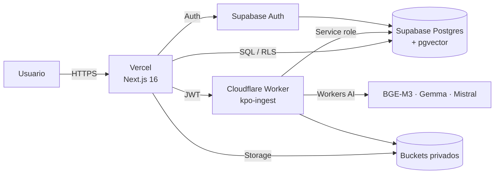

# Despliegue — KPO Agent AI

Guía para publicar la aplicación con **Vercel + Cloudflare Worker + Supabase**. El proyecto todavía no está desplegado; este documento describe el procedimiento previsto y las verificaciones necesarias.

## 1. Arquitectura objetivo



| Componente | Plataforma | Estado |
| --- | --- | --- |
| App Next.js | Vercel | Pendiente |
| Worker de ingesta/IA | Cloudflare | Pendiente |
| Auth/Postgres/Storage | Supabase | Proyecto remoto con migraciones aplicadas |
| Repositorio | GitHub privado | Push completado; confirmar visibilidad privada |

## 2. Preflight local

Desde la raíz del repositorio:

```bash
npm ci
npm run lint
npm test
npm run build
```

Worker:

```bash
cd workers/kpo-ingest
npm ci
npm run typecheck
npm test
npm run dry-run
```

Verificar además:

- `.env.local` y `.dev.vars` no están versionados.
- No hay claves, JWT ni correos reales en Git.
- `npm run build` termina sin errores.
- Las migraciones 1–9 están aplicadas en Supabase. La 10 está pendiente y es necesaria antes de desplegar la fase 6.
- Los buckets `documents-original` y `documents-processed` son privados.
- El corpus local no se sube al repositorio.

## 3. Supabase

### 3.1 Migraciones

Aplicar en orden:

```text
202611060001_initial_identity_and_access.sql
202611070001_invitation_long_expiry.sql
202611080001_short_invitation_codes.sql
202611090001_invitation_code_history.sql
202611090002_revoke_user_sessions.sql
202611100001_documents_and_ingestion.sql
202611110001_document_version_publication.sql
202611110002_agent_retrieval.sql
202611120001_audit_events_chain.sql
202611120002_audit_events_immutable_refs.sql
202611120003_agent_out_of_scope.sql
```

La migración 9 crea `audit_events`, `append_audit_event`, `verify_audit_chain` y los disparadores de auditoría. Es obligatoria para `/admin/audit/events`, `/admin/reports` y la exportación CSV. La migración 10 elimina las FKs mutables de `audit_events` y repara eventos afectados. La migración 11 amplía los resultados del agente con `out_of_scope`. Verifica en cada entorno con `select * from public.verify_audit_chain(null);`.

Con CLI:

```bash
supabase link --project-ref <project-ref>
supabase db push
```

O aplicar el SQL desde el Dashboard. No reaplicar migraciones ya registradas.

### 3.2 Auth

En **Authentication → URL Configuration**:

- **Site URL:** `https://<dominio-produccion>`
- **Redirect URLs:**
  - `https://<dominio-produccion>/auth/callback`
  - `https://<dominio-produccion>/**`
  - Añadir previews de Vercel solo si se usarán:
    `https://<proyecto>-*.vercel.app/**`

En **Authentication → Providers → Email**:

- **Confirm email:** desactivado en la configuración actual.
- Si se activa, configurar SMTP propio y verificar el flujo `/verify-email` y `/auth/callback`.

> Sin SMTP propio, la recuperación de contraseña por correo no es fiable. El login con contraseña sí funciona.

### 3.3 Storage

Verificar:

- `documents-original` privado.
- `documents-processed` privado.
- Políticas de Storage aplicadas.
- El frontend no recibe URLs públicas permanentes.
- Los documentos no están en Git ni en `public/`.

### 3.4 Primera cuenta

Crear el superadministrador con el Admin API y `app_metadata.bootstrap_superadmin = true`. La marca solo se acepta cuando no existe ningún superadministrador y se elimina al crear el perfil.

Nunca uses `user_metadata` para esta marca ni ejecutes el bootstrap desde el navegador.

## 4. Cloudflare Worker

### 4.1 Configuración

Archivo: `workers/kpo-ingest/wrangler.jsonc`.

Verificar:

- `name: "kpo-ingest"`.
- `compatibility_date` y `nodejs_compat`.
- Binding `AI`.
- Modelos:
  - `AI_EMBEDDING_MODEL=@cf/baai/bge-m3`
  - `AI_CHAT_MODEL=@cf/google/gemma-4-26b-a4b-it`
  - `AI_OCR_MODEL=@cf/mistralai/mistral-small-3.1-24b-instruct`
- `ALLOWED_ORIGINS` con el dominio de producción, separado por comas si hay varios.
- `MAX_UPLOAD_BYTES`, chunking y OCR.

No dejes `http://localhost:3000` en producción salvo que sea intencional.

### 4.2 Secretos

```bash
cd workers/kpo-ingest
npx wrangler login
npx wrangler secret put SUPABASE_URL
npx wrangler secret put SUPABASE_ANON_KEY
npx wrangler secret put SUPABASE_SERVICE_ROLE_KEY
```

- `SUPABASE_SERVICE_ROLE_KEY` nunca se expone al navegador.
- No se escribe en `wrangler.jsonc`, README ni Git.
- `.dev.vars` es solo para local y está ignorado.

### 4.3 Desplegar

```bash
npm run typecheck
npm test
npm run dry-run
npm run deploy
```

Guardar la URL resultante, por ejemplo:

```text
https://kpo-ingest.<subdominio>.workers.dev
```

Verificar:

```bash
curl -s https://<worker-url>/health
```

El health debe reportar bindings y modelos configurados. Después probar `/embed-test` con un JWT real y una consulta del agente.

### 4.4 Orden recomendado con Vercel

1. Crear el proyecto en Vercel y conocer el dominio de producción.
2. Configurar `ALLOWED_ORIGINS` con ese dominio.
3. Desplegar el Worker.
4. Configurar `INGEST_WORKER_URL` en Vercel con la URL del Worker.
5. Desplegar la app.
6. Si el dominio cambia, actualizar `APP_ORIGIN` y `ALLOWED_ORIGINS` y redesplegar.

## 5. Vercel

### 5.1 Importar el repositorio

- Repositorio: privado en GitHub.
- Framework: Next.js.
- Root Directory:
  - `.` si el repo es `KPO-AGENT-IA` con la app en la raíz.
  - `web` si el repo incluye una carpeta contenedora.
- Build Command: `npm run build`.
- Install Command: `npm ci`.
- Node.js: 22 LTS o versión compatible con Next.js 16.

### 5.2 Variables de entorno

Configurar en **Production** y, si se usan previews, en **Preview**:

| Variable | Valor |
| --- | --- |
| `NEXT_PUBLIC_SUPABASE_URL` | `https://<project-ref>.supabase.co` |
| `NEXT_PUBLIC_SUPABASE_PUBLISHABLE_KEY` | Clave publicable de Supabase |
| `INGEST_WORKER_URL` | URL HTTPS del Worker |
| `APP_ORIGIN` | `https://<dominio-produccion>` |
| `SUPABASE_SERVICE_ROLE_KEY` | Clave server-side para el panel de alertas de seguridad |

`SUPABASE_SERVICE_ROLE_KEY` es necesaria para que `/admin/security` pueda leer eventos de todos los usuarios. Debe ser solo server-side y nunca llevar prefijo `NEXT_PUBLIC_`.

No configurar tokens de Cloudflare en Vercel: el Worker se despliega aparte.

### 5.3 Deployment Protection

Si Vercel tiene **Deployment Protection** activo, la URL pública puede exigir login de Vercel. Para una entrega accesible:

- desactivar protección para Production, o
- configurar un dominio público sin protección.

Verificar en una ventana privada.

## 6. Smoke tests de producción

### Autenticación

- `/login` carga y autentica superadmin.
- `/app` carga sin overlay de Next.js.
- `/app/history` carga.
- Un usuario `analyst` entra y no ve rutas admin.

### Documentos

- `/admin/documents` muestra la biblioteca y el contador de fragmentos.
- El detalle de un documento muestra versiones y fragmentos.
- Subir un PDF pequeño y comprobar `pending_review`.
- Aprobar y publicar; verificar que el agente lo usa.
- Verificar que un documento retirado deja de aparecer en consultas.

### Agente

- Pregunta respondible: devuelve respuesta y citas.
- Pregunta sin evidencia: se abstiene y no inventa fuentes.
- Intento de extracción de prompt: bloqueado.
- Solicitud de secretos: bloqueada.
- Consulta cruzada de grupo: bloqueada.
- Historial: la consulta aparece con outcome, modelo, latencia y fuentes.

### Infraestructura

- `GET /health` del Worker responde.
- `/embed-test` responde con un JWT real.
- Los logs de Vercel no muestran secretos.
- Los logs de Cloudflare no muestran JWT completos ni service role.
- Los buckets siguen privados.
- RLS impide leer documentos de otro grupo.
- Rate limit responde 429 al superar 20 consultas/minuto.

## 7. Backups, logs y monitoreo

- Confirmar backup/PITR de Supabase según el plan.
- Revisar logs de Vercel para errores de build, Auth y API.
- Revisar `wrangler tail` para errores del Worker.
- Revisar métricas de Workers AI y cuotas.
- Configurar alertas de errores 5xx si el plan lo permite.
- Documentar cualquier incidente en `docs/PROJECT_MEMORY.md`.

## 8. Rollback

### Vercel

- Promover el deployment anterior desde el dashboard.
- O revertir el commit y volver a desplegar.

### Cloudflare

```bash
cd workers/kpo-ingest
npx wrangler rollback
```

O desplegar la versión anterior del código.

### Supabase

- Las migraciones 9 (`audit_events_chain`) y 10 (`audit_events_immutable_refs`) ya están aplicadas. La 11 (`agent_out_of_scope`) está pendiente. Para rollback, conserva la tabla y los datos: no la elimines si ya hay eventos.
- Antes de cambios de esquema futuros, crear backup o verificar PITR.
- No borrar tablas ni buckets durante un rollback de aplicación.

## 9. Limitaciones del despliegue provisional

- Fase 6 implementada; migraciones 9 y 10 aplicadas y cadena verificada. Falta aplicar la migración 11 (`out_of_scope`), validar triggers en producción y desplegar. Fase 7 (simulador) pendiente.
- Sin despliegue público todavía.
- OCR síncrono dentro de `maxDuration = 60`.
- Proxy de Vercel con límite de cuerpo (~4.5 MB); el corpus actual está por debajo.
- Sin SMTP propio; confirmación y recuperación por correo limitadas.
- Rate limit no probado con carga real.
- El corpus local de 15 documentos y 1.185 fragmentos no se versiona.

## 10. Checklist final

- [ ] Migraciones aplicadas y verificadas.
- [ ] Buckets privados y políticas comprobadas.
- [ ] Worker desplegado con secretos.
- [ ] `ALLOWED_ORIGINS` con el dominio de producción.
- [ ] Vercel desplegado con variables correctas.
- [ ] Supabase Site URL y Redirect URLs configuradas.
- [ ] Deployment Protection desactivado o acceso validado.
- [ ] Login superadmin y analyst probados.
- [ ] Consulta RAG con citas y abstención probadas.
- [ ] Historial, eventos auditados y reportes visibles.
- [ ] `verify_audit_chain` responde íntegro y la exportación CSV registra `audit_export`.
- [ ] Sin secretos en logs, Git ni respuestas del navegador.
- [ ] Backups y monitoreo revisados.
- [ ] README y documentación actualizados con la URL final.
